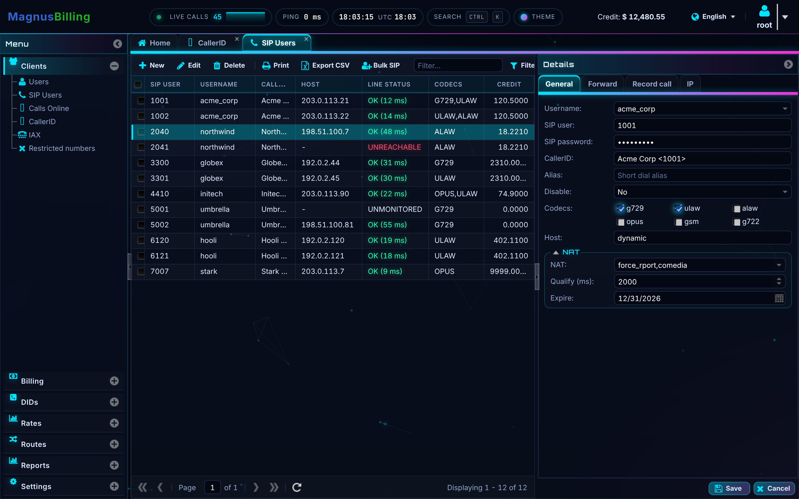
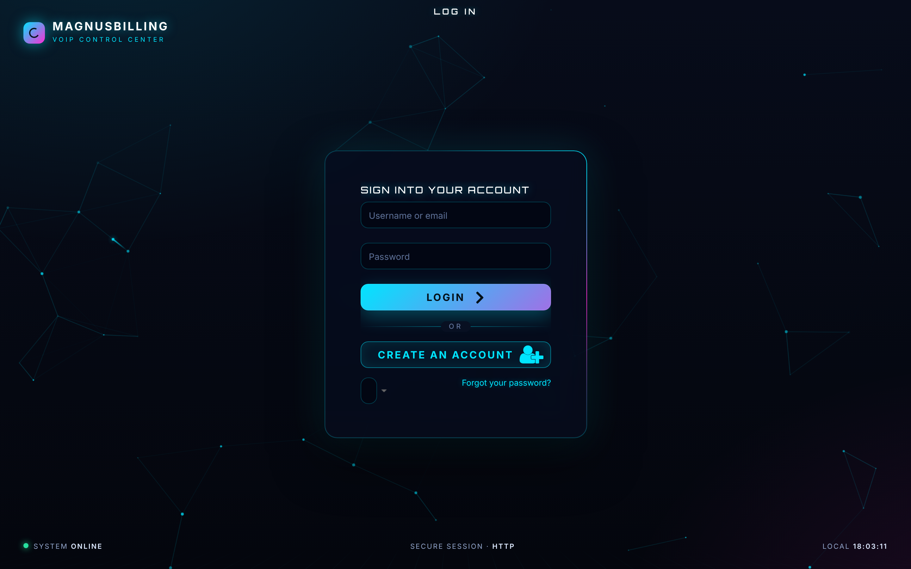
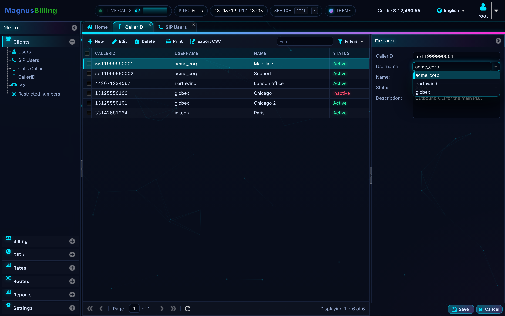
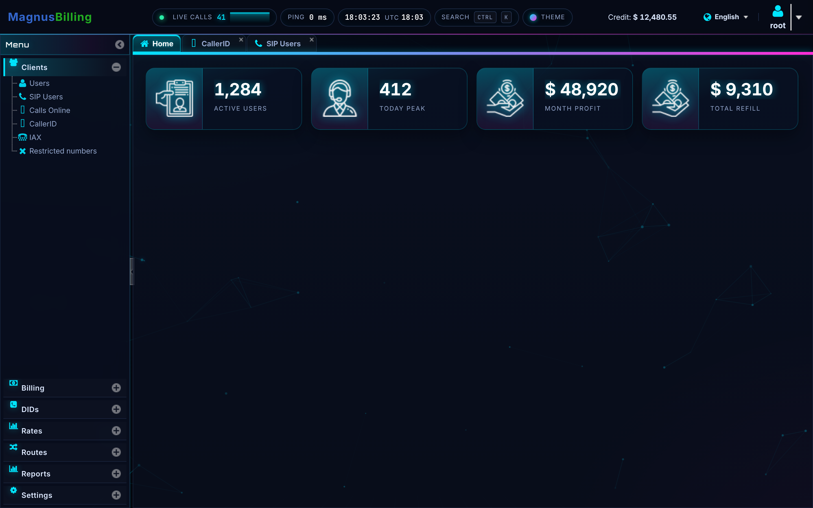
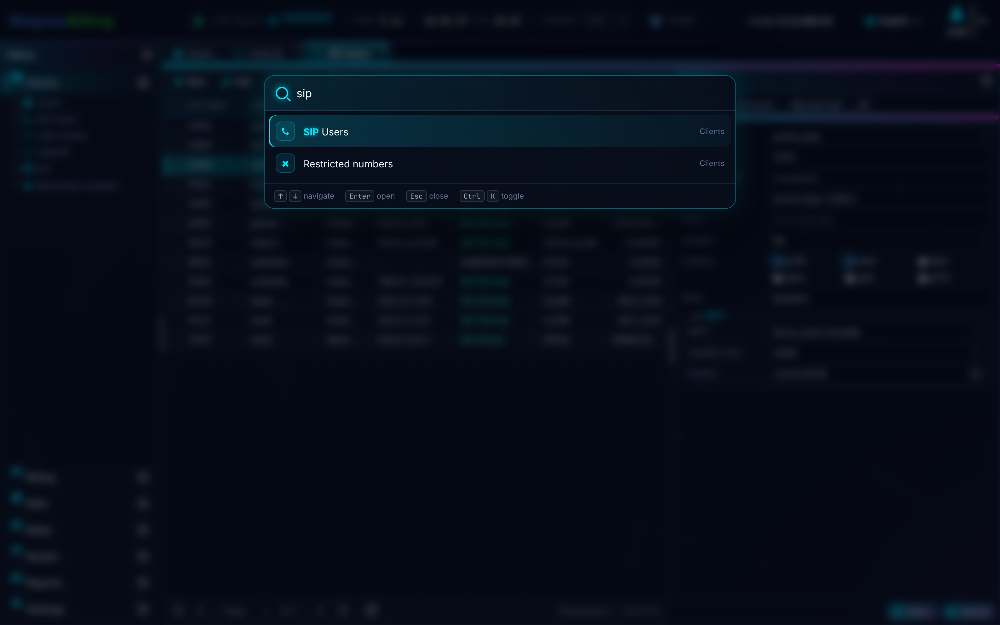
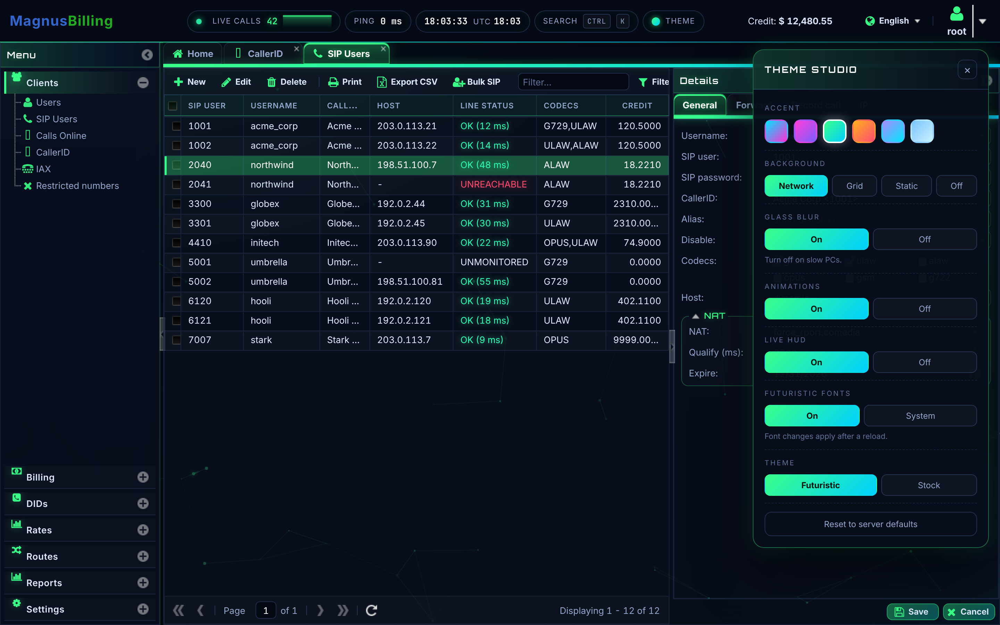
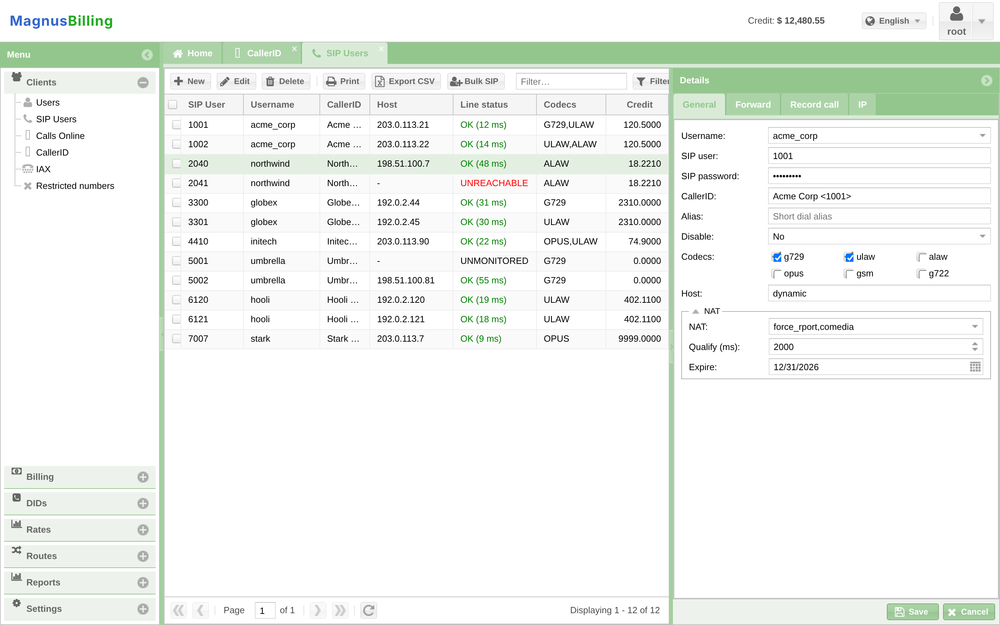

# MagnusBilling 8 — Futuristic Theme

A dark, neon, "VoIP control center" redesign for the **MagnusBilling 8** admin panel. It installs over SSH with one command and sits on top of your existing install, so nothing in MagnusBilling's code or database is replaced.



| Login | Caller ID | Dashboard |
|---|---|---|
|  |  |  |

| Command palette (Ctrl/Cmd + K) | Theme Studio | Stock look, for comparison |
|---|---|---|
|  |  |  |

## What you get

**Every menu and every option is restyled**, not just the outer frame. MagnusBilling builds all its modules (SIP Users, Caller ID, Users, Plans, Tariffs, Trunks, Providers, DIDs, IVRs, Queues, Refills, CDR, reports, settings…) from the same ExtJS pieces. The theme restyles each piece:

- list grids: headers, rows, selection, status colours, paging bar, filters, checkboxes
- edit forms: text fields, combos, lookups, number spinners, date pickers, checkbox groups, fieldsets, tabs, Save/Cancel
- windows, message boxes, menus, drop-downs, tooltips, loading masks, toast alerts
- the accordion side menu, tab bar, top bar, login and sign-up screens, dashboard cards and charts
- the Windows-style and macOS-style desktop layouts (taskbar, windows, shortcuts)

**New features:**

| Feature | What it does |
|---|---|
| **Animated network background** | Nodes and "call packets" moving along links. Reacts to the mouse, runs at about 30 fps, and pauses when the tab is hidden. |
| **Live HUD bar** (admins) | Live call count with a sparkline (click it to open *Calls Online*), panel latency, local and UTC clock, plus Search and Theme buttons. |
| **Command palette** — `Ctrl+K` / `⌘K` | Type a few letters to jump to any module: `sip` → SIP Users, `cid` → CallerID, `trnk` → Trunks. Also runs actions: close tab, close others, reload list, collapse menu, full screen, change accent. Recent modules are listed first. |
| **Theme Studio** | Six accent colours (Cyan, Magenta, Matrix, Amber, Violet, Ice), background (Network / Grid / Static / Off), glass blur, animations, HUD, fonts, and a futuristic/stock switch. Settings are saved per browser. |
| **Login HUD** | Brand and tagline, a "system online" status line, session security (TLS/HTTP) and a live clock around a glass card with an animated neon rim. |
| **Dashboard pulse** | Dashboard cards glow briefly each time their numbers refresh. |
| **Safe toggles** | `Ctrl+Alt+F` switches to the stock look in your browser. `?mbf=off` in the URL loads the stock look once. `mbf-theme disable` turns it off for everyone. |

## Install (SSH, as root, on the MagnusBilling server)

```bash
curl -fsSL https://raw.githubusercontent.com/thedevilhackers/torque-guide-telegram-bot/claude/happy-ramanujan-61c1eu/magnusbilling8-futuristic/install.sh -o mbf-install.sh && bash mbf-install.sh
```

Then open the panel and press **Ctrl+F5** (hard refresh).

Install with your own branding and colour:

```bash
bash mbf-install.sh --accent magenta --tagline "Acme Voice Cloud"
```

`install.sh` is self-contained: it carries the theme files inside it and checks their SHA-256 before installing. It doesn't download anything else. It also works offline: copy the file over with `scp` and run it.

### Install options

| Option | Meaning |
|---|---|
| `--path DIR` | MagnusBilling folder. Default is auto-detected (`/var/www/html/mbilling`). |
| `--accent NAME` | `cyan` (default), `magenta`, `matrix`, `amber`, `violet`, `ice` |
| `--background NAME` | `network` (default), `grid`, `static`, `off` |
| `--tagline "TEXT"` | Text under the brand name on the login screen (max 60 characters). |
| `--no-google-fonts` | Use system fonts and make no requests to `fonts.googleapis.com`. |
| `--no-hud` | Hide the live HUD bar. |
| `--hud-poll SECONDS` | Live-calls refresh interval, 5–300 (default 10). |
| `--no-glass` / `--no-motion` | Turn off blur or animations (for slow PCs). |
| `--keep-login-background` | Keep the login image uploaded in MagnusBilling (it gets a dark overlay). |
| `--lock` | Users can't change the look in Theme Studio. |
| `--no-auto-reapply` | Don't install the cron job (see below). |

## Manage it later

The installer adds a small tool, `mbf-theme`:

```bash
mbf-theme status
```

```bash
mbf-theme set ACCENT matrix
```

```bash
mbf-theme disable
```

```bash
mbf-theme enable
```

```bash
mbf-theme uninstall --purge
```

`set` keys: `ENABLED ACCENT BACKGROUND GLASS MOTION GOOGLE_FONTS HUD HUD_POLL PALETTE KEEP_LOGIN_BG CHART_FIX LOCK AUTO_REAPPLY TAGLINE MB_PATH`

## How it works, and what it changes on your server

| Path | What |
|---|---|
| `/var/www/html/mbilling/resources/futuristic/` | `mbf.css`, `mbf.js`, `mbf-config.js` (your settings) |
| `/var/www/html/mbilling/index.html` | One 4-line block right after `resources/init.css`, marked `MBF:BEGIN … MBF:END` |
| `/usr/local/sbin/mbf-theme` | The management tool |
| `/usr/local/share/mbf-theme/` | Pristine copy of the theme files, used to repair after updates |
| `/etc/mbf-theme.conf` | Your settings |
| `/etc/cron.d/mbf-theme` | Every 5 minutes, re-adds the hook only if it's missing |
| `/var/backups/mbf-theme/` | Backups of `index.html` taken before each change (last 10 kept) |

- **Survives MagnusBilling updates.** MagnusBilling's nightly auto-update (`protected/commands/update.sh`, 01:30) unpacks a new `index.html`. The cron job notices the hook is gone and puts it back within 5 minutes. It doesn't touch anything else.
- **No database, Asterisk or PHP changes.** The only server request the theme makes is for admins: a read of `index.php/callOnLine/read` (the same endpoint the *Calls Online* screen uses). It runs only while the tab is visible and pauses after 15 minutes without mouse or keyboard activity, so idle sessions still time out normally.
- **Layout-safe.** ExtJS measures sizes in JavaScript, so the theme changes colours, backgrounds, border colours, radii, shadows and fonts, but keeps the stock paddings, heights and border widths. The stock screenshot above has exactly the same layout as the themed ones.
- **Works with every base theme.** It's tested on Neptune (MagnusBilling 8's default is `black-neptune`). It detects Triton, Crisp and Classic and adapts icon handling: Triton uses font icons, the others use image sprites.
- **Google Fonts** (Inter, Orbitron, JetBrains Mono) load without blocking. If they can't be reached, the panel uses system fonts with no delay. Use `--no-google-fonts` to never contact Google.

## Troubleshooting

- **Nothing changed** → press `Ctrl+F5`, then check with `mbf-theme status`.
- **Something looks wrong** → open the panel with `?mbf=off` (for example `https://your-server/mbilling/?mbf=off`) or press `Ctrl+Alt+F`, then report it.
- **Slow PC** → `mbf-theme set GLASS 0` and `mbf-theme set BACKGROUND static`, or use Theme Studio.
- **Remove everything** → `mbf-theme uninstall --purge`. It removes the hook and every file listed above (backups are kept).

## Developing

```
src/mbf.css              the theme (all rules scoped to html.mbf)
src/mbf.js               runtime: loader, background, HUD, palette, Theme Studio
tools/mbf-theme          server management tool
tools/installer.head.sh  installer template
build.sh                 builds the self-contained install.sh
```

After editing anything in `src/` or `tools/`, run `./build.sh` (and `./build.sh --check` in CI). For sandbox testing, `MBF_ROOT=/tmp/sandbox bash install.sh --path /tmp/sandbox/var/www/html/mbilling` installs everything under a prefix instead of `/`.

License: GPL-3.0-or-later, like MagnusBilling. MagnusBilling is a trademark of its owners; this is an independent, unofficial theme.
